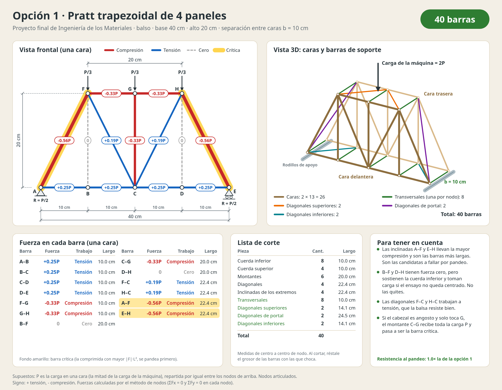
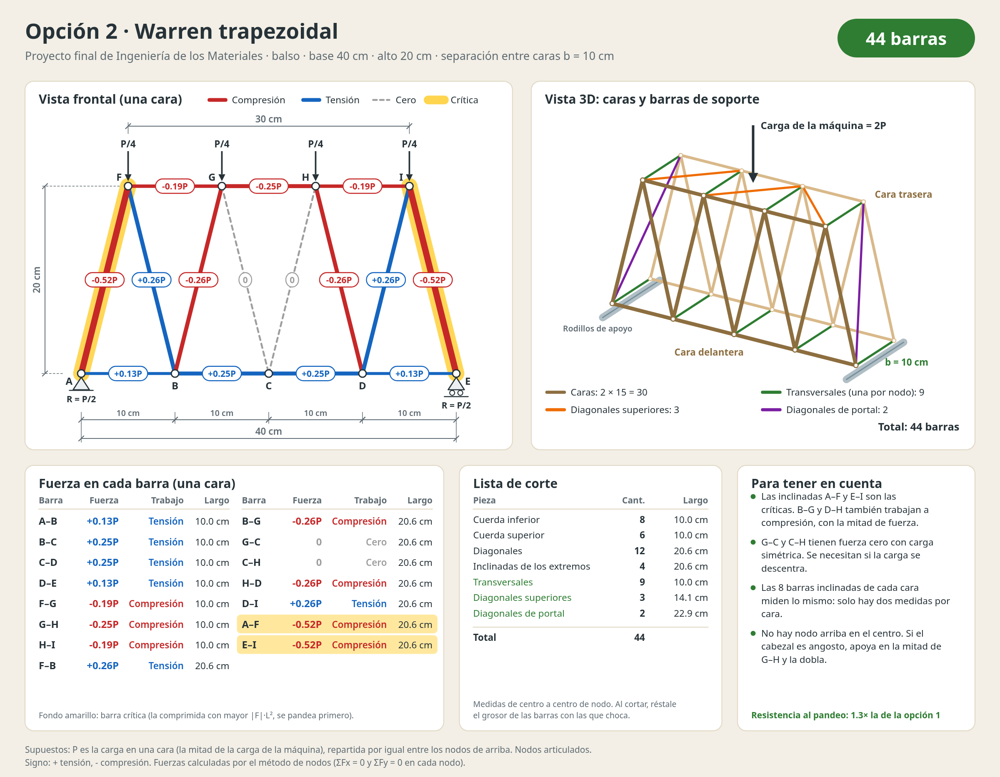
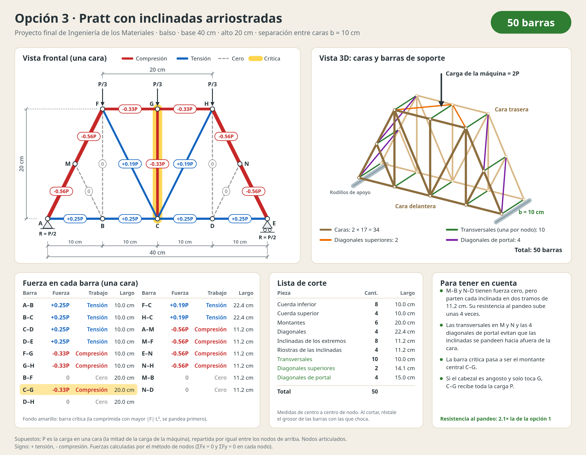

# Cercha de balso: opciones de 40 a 50 barras

Láminas con tres ideas de cercha para el proyecto final de Ingeniería de los Materiales. Todas mantienen las medidas del prototipo: 40 cm de base y 20 cm de alto, con dos caras iguales unidas por barras de soporte.

| Opción | Barras | Barra crítica | Resistencia al pandeo (relativa a la opción 1) |
|---|---|---|---|
| 1 · Pratt de 4 paneles | 40 | A–F y E–H (−0.56P, 22.4 cm) | 1.0× |
| 2 · Warren trapezoidal | 44 | A–F y E–I (−0.52P, 20.6 cm) | 1.3× |
| 3 · Pratt arriostrada | 50 | C–G (−0.33P, 20.0 cm) | 2.1× |

## Láminas






Cada lámina trae la vista frontal con la fuerza de cada barra, una vista 3D con las barras de soporte (transversales, diagonales superiores y de portal), la tabla de fuerzas, la lista de corte y notas.

## Cómo se cuentan las barras

- Cada tramo entre dos nodos cuenta como una barra.
- Hay una transversal en cada nodo, uniendo la cara de adelante con la de atrás.
- Las diagonales superiores arriostran la parte de arriba. Las diagonales de portal arriostran los planos inclinados de los extremos.

## Supuestos

- P es la carga que recibe una cara, es decir, la mitad de la carga de la máquina. Se reparte por igual entre los nodos de arriba.
- Nodos articulados. Signo: + tensión, − compresión.
- La barra crítica es la comprimida con mayor |F|·L², que es la que se pandea primero si todas las barras tienen la misma sección.
- Separación entre caras b = 10 cm. Cámbiala por tu medida real.

## Volver a generar las láminas

```bash
python3 generar_laminas.py        # b = 10 cm
python3 generar_laminas.py 12     # b = 12 cm
```

El script solo usa Python estándar. Calcula las fuerzas por el método de nodos y escribe los archivos `.svg`. Los `.png` se exportaron desde los `.svg` con un navegador.
